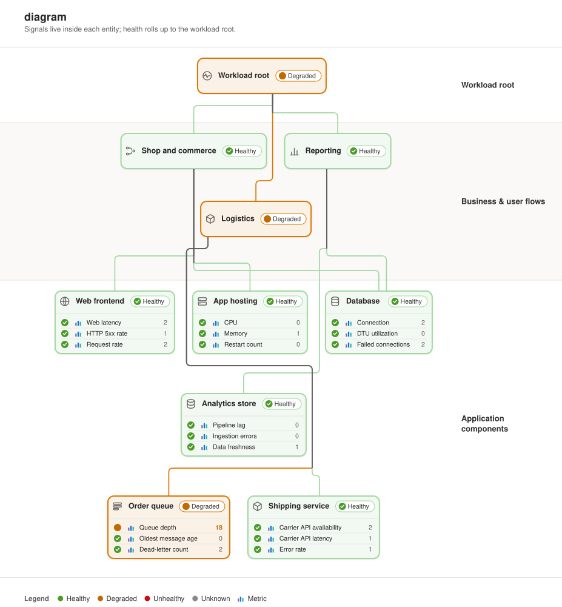
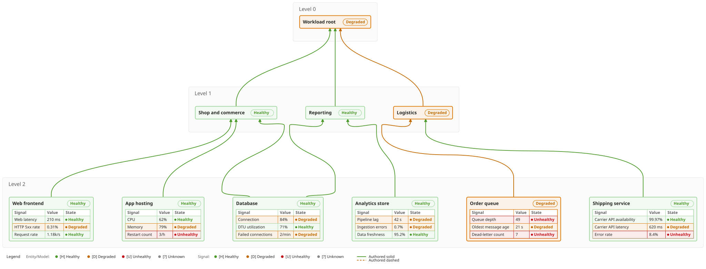
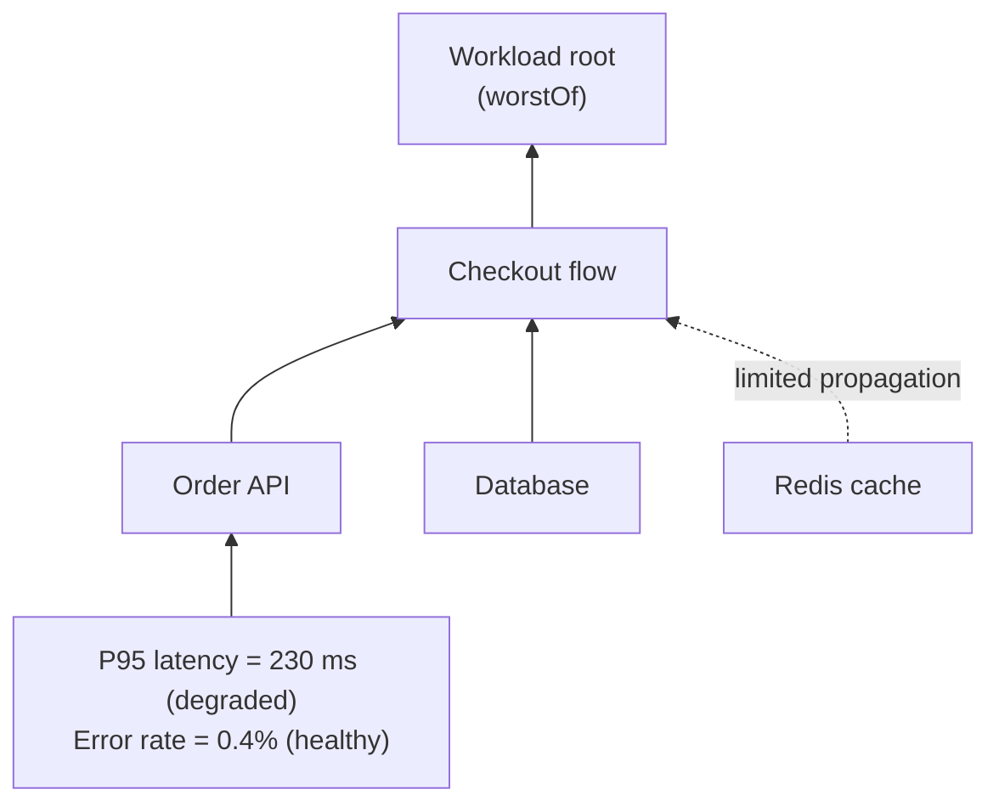
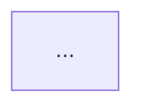
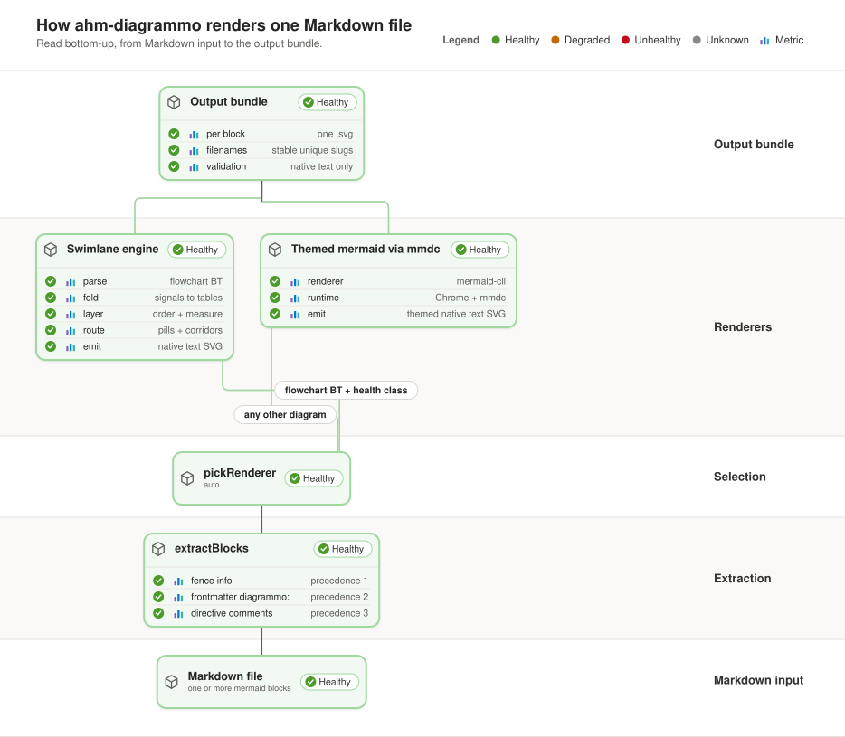

# ahm-diagrammo

Turn the ` ```mermaid ` blocks in a Markdown file into static SVG files.

- **Azure health models** get a purpose-built look: Azure-portal style **swimlanes** (default) or
  **Pele** signal tables (`-r pele`), from the same Mermaid source.
- **Every other Mermaid diagram** (sequence, state, ER, flowchart, pie, ...) is rendered by
  [Pele](https://pele.run) in the same theme, so a whole document looks consistent.
- The SVGs use native text and fixed colors, so they work as `` on GitHub and Microsoft Learn.
  No browser, no Chrome, no system fonts are involved.



The same [source](hero.md) with `-r pele`:



**[See the gallery](docs/gallery/README.md)**: every feature, each health model in both looks.

## Quick start

Node 20 or newer. Run from a checkout (the package is not published to npm):

```bash
git clone https://github.com/abossard/ahm-diagrammo.git && cd ahm-diagrammo && npm ci
```

Render every Mermaid block in a Markdown file into `out/`, one SVG per block:

```bash
node bin/diagrammo.mjs hero.md -o out
```

Same file, Pele look for health models:

```bash
node bin/diagrammo.mjs hero.md -o out -r pele
```

## Write a health model

A health model is a `flowchart BT` whose nodes carry health classes. Children point at their
parents, so health rolls up to the root at the top:



| You write | It means |
|-----------|----------|
| `class x green` / `amber` / `red` / `purple` | healthy / degraded / unhealthy / standby; no health class means unknown |
| `class s blue` | `s` is a signal: each label line becomes a row in its entity's table |
| `name = value (state)` in a signal label | a row with its own value and state (`healthy`, `degraded`, `unhealthy`, `unknown`) |
| `child --> parent` | a roll-up; the connector takes the child's state color |
| `-->\|label\|` and `-. "label" .->` | a labeled roll-up and a dashed one (limited propagation) |
| `(worstOf)` as a label line | a qualifier, shown under the name |

Anything else is an ordinary Mermaid diagram. The [gallery](docs/gallery/README.md) shows every
rule with a rendered example.

## Choose the look

| `renderer` | Health model | Any other diagram |
|------------|--------------|-------------------|
| `auto` (default) | swimlane | Pele |
| `swimlane` | swimlane | swimlane parser (health models only) |
| `pele` | Pele signal tables | Pele |
| `mermaid` | Mermaid shapes, themed | Pele |

Set it for a run with `-r` or for one block with `renderer:` (see below).

## Options per block

Every option can live in the block itself. All three places are invisible to GitHub's and VS
Code's Mermaid preview; later ones win:

````markdown

````

| Key | What it does |
|-----|--------------|
| `renderer` | `auto`, `swimlane`, `pele` or `mermaid` |
| `theme` | `portal` (default), `midnight`, `candy`, `slate` |
| `title` / `subtitle` | header text of the swimlane look (title defaults to the nearest heading) |
| `lanes` | swimlane row names, top to bottom |
| `legend` | `false` hides the legend (both looks) |
| `laneLabels` | `false` hides the swimlane lane names and reclaims their gutter |
| `name` | output file name (defaults to a slug of the title or heading) |
| `background` | canvas color for non-health diagrams |
| `alt` | alt text of the image written by `--sync-markdown` |

The full reference, with every guarantee and the test that pins it, is [docs/FEATURES.md](docs/FEATURES.md).

## Publish to GitHub or Microsoft Learn

`--sync-markdown` renders the SVGs and rewrites each fence in place into a visible image followed
by the Mermaid source, fully hidden in an HTML comment. Edit the hidden source, rerun, commit both.
`--image-format learn` writes Microsoft Learn's `:::image:::` directive instead of ``:

```bash
node bin/diagrammo.mjs docs/health.md -o docs/assets --sync-markdown --image-format learn
```

Reruns are idempotent and file names stay stable. [examples/sync-markdown/](examples/sync-markdown/)
is a real synced file. On Learn, `.svg` must be listed in the docset's `docfx.json` resources.

## Use it as a library

```js
import { renderDiagram, renderAhm } from "ahm-diagrammo";

// one entry point for every look: renderer is auto | swimlane | pele | mermaid
const { svg } = renderDiagram(mermaidSource, { renderer: "pele", theme: "slate" });

// the Pele look with options the CLI does not expose
const { svg: wide } = renderAhm(flowchartSource, { direction: "LR", lanes: true, tableHeaders: false, fontSize: 18 });
```

`renderAhm` also takes `colors` (palette overrides), `fontFamily`, `legend`, `idPrefix`, size
limits and `nested` (model views); the gallery shows each one. Runnable scripts live in
[examples/](examples/README.md).

## Gallery

[docs/gallery/README.md](docs/gallery/README.md) is generated from
[docs/gallery/source.md](docs/gallery/source.md). To add or change an example, edit the source
and regenerate:

```bash
npm run gallery
```

CI runs `npm run gallery:check`, which fails when the committed gallery is out of date.

## How it works

The CLI calls `prepareDocuments` in `src/document.mjs` to find the blocks, merge their options and
pick a renderer, then `renderDiagram` in `src/render.mjs` for each block. Library callers use the
same two functions. ahm-diagrammo draws its own pipeline
([source](docs/how-it-works.md)):



## Command line

```text
node bin/diagrammo.mjs <file.md> [more.md ...] [options]

  -o, --out <dir>          output directory (default: ./diagrams)
  -t, --theme <name>       portal | midnight | candy | slate (default: portal)
  -r, --renderer <name>    auto | swimlane | pele | mermaid (default: auto)
  -l, --list               show what each block becomes, write nothing
  -v, --verbose            log every parsed node, edge and signal fold
      --strict             warnings fail the run
      --sync-markdown      write images plus hidden source back into the Markdown
      --image-format <f>   commonmark | learn (with --sync-markdown)
```

## Development

```bash
npm test
```

After an intended change to the swimlane look, refresh the pinned outputs with `npm run goldens`
and `npm run gallery`, then review the SVG diffs. Tests rasterize SVGs with the bundled Unifont
fonts in `test/assets/fonts`; system fonts are never loaded.

## License

MIT (see `LICENSE`). The renderers draw only original, in-code glyphs; no third-party icons.
