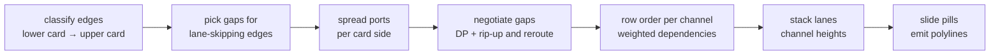

# Edge routing in the swimlane look

How `src/swimlane-route.mjs` draws connectors, which alternatives were measured, and why the
layered channel router won over a generic orthogonal router. The Pele look reuses the same router
for its lanes ([below](#the-pele-looks-lanes)).

## The problem

In the AKS top-level rollup, five children fan into one parent. The old router:

- entered the parent only at its two bottom corners, ports 8px apart and bus rows 4px apart, so
  sibling lines ran as near-duplicates
- stacked bus rows by left-edge interval packing, which ignores which line must sit above which,
  so Autoscaling's horizontal crossed Traffic's drop

## Requirements

- One line per edge, in its source's state color (no shared trunks).
- Ports spread across the card side, in the order their edges go.
- Parallel lines of different edges at least 10px apart.
- Cards never move. Only lines, ports and channel heights change.
- Winner decided lexicographically per diagram: overlap (collinear, through a card, through a
  pill, closer than 10px, pill detached from its edge) > crossings > bends > length.

## Two families of algorithms

| | Layered channel routing | Generic orthogonal routing |
|---|---|---|
| Idea | Edges between two lanes are 3-segment routes in the channel between them; only the row order of the horizontals is decided | Shortest paths with bend cost through an orthogonal visibility graph around obstacles, then segments are nudged apart |
| Sources | Left-edge algorithm and vertical constraint graph ([Hashimoto & Stevens 1971](https://doi.org/10.1145/800158.805069)), dogleg routing ([Deutsch 1976](https://doi.org/10.1145/800146.804843)), orthogonal hyperedge routing in layered drawings ([Sander, GD 2003](https://doi.org/10.1007/978-3-540-24595-7_35)) as implemented in [ELK's OrthogonalRoutingGenerator](https://github.com/eclipse-elk/elk/blob/master/plugins/org.eclipse.elk.alg.layered/src/org/eclipse/elk/alg/layered/p5edges/orthogonal/OrthogonalRoutingGenerator.java), port constraints ([Schulze, Spönemann, von Hanxleden 2014](https://doi.org/10.1016/j.jvlc.2013.11.005)) | libavoid ([Wybrow, Marriott, Stuckey, GD 2009](https://doi.org/10.1007/978-3-642-11805-0_22)), maze and line-probe routers (Lee 1961, Hightower 1969), negotiated congestion ([PathFinder, McMurchie & Ebeling 1995](https://doi.org/10.1145/201310.201328)) |
| Crossings | Optimized directly: a dependency per overlapping pair, weighted by the crossings each order costs | Not part of libavoid's path cost; its `crossingPenalty` is ["still experimental … not recommended for normal use"](https://github.com/mjwybrow/adaptagrams/blob/master/cola/libavoid/router.h) |
| Spacing | Guaranteed: rows are a fixed pitch apart and the channel grows | A target: libavoid's `idealNudgingDistance` (default 4) |
| Labels | A label pill is a taller row | Not handled; pills must be placed afterwards |

Published evidence points the same way. [Hegemann & Wolff (GD 2023)](https://arxiv.org/abs/2309.01671)
kept Praline's node positions and swapped only the router. Their own shortest-path routing
("Hybrid1") had 1.30× Praline's crossings on the Topology Zoo and 1.03× on pseudo-cableplans. Their
paper notes that "the edge routing algorithm of Wybrow et al. does not take crossings into account".
I found no published head-to-head comparison on fixed layered positions, hence the experiment below.

## Experiment

A throwaway harness (not in the repo) swapped the router module inside the real renderer and
scored every result with the repo's own verifier (`test/helpers/geo.mjs`).

- Corpus: 96 diagrams. All 36 swimlane health models in the repo (README examples, gallery,
  fixtures, AKS) plus 60 seeded graphs: fan-ins of 2–12, trees, multi-parent meshes,
  lane-skipping edges, labels and dashes, and mixes.
- Contenders:
  - **baseline**: the old router.
  - **channel**: this router, tuned in the iterations below.
  - **libavoid**: [libavoid-js](https://github.com/Aksem/libavoid-js) 0.5.0-beta.5 (WASM). Same
    ports as the channel router, cards as obstacles, pills placed on each route afterwards and then
    added as obstacles for a second pass, with every pill re-attached to its final route.

### Iterations of the channel router

| Step | Overlap | <10px | Crossings | Bends | Clean diagrams |
|---|---|---|---|---|---|
| baseline | 1 | 335 | 462 | 1226 | 41 / 96 |
| ports spread and ordered, crossing-weighted row order, 10px pitch | 4 | 1 | 223 | 1238 | 92 |
| weighted ports (straight drops win), pills ordered with all rows, risers moved off nearby ports | 4 | 0 | 193 | 1236 | 92 |
| a vertical through a pill's spot costs 4 crossings in the row order | 0 | 0 | 195 | 1236 | 96 |
| gap search per lane-skipping edge (dynamic programming over lanes, 2 negotiation rounds) | 0 | 0 | 191 | 1218 | 96 |
| rip-up and reroute: each lane-skipping edge tries its 6 best gap chains, exact re-scoring | 0 | 0 | 179 | 1228 | 96 |
| a port landing a hair past its card's span (float error) still counts as a straight drop | 0 | 0 | 177 | 1200 | 96 |

Weight sweeps (gap crossing cost 3–30, pill cost 4–8, straight-port weight 5–50, 0–4 negotiation
rounds) moved crossings by at most 4.

### libavoid settings

| Bend penalty | Crossing penalty | Pill pass | Overlap | <10px | Crossings | Bends | Clean |
|---|---|---|---|---|---|---|---|
| 50 | off | yes | 14 | 6 | 251 | 1526 | 82 |
| 200 | 1000 | yes | 20 | 6 | 137 | 1624 | 81 |
| 50 | off | no | 51 | 4 | 210 | 1182 | 74 |
| 200 | 1000 | no | 55 | 11 | 134 | 1286 | 74 |
| 200 | 1000, given the channel router's channel heights | yes | 33 | 7 | 147 | 1624 | 79 |

### Result

| | Overlap | <10px | Crossings | Bends | Length | Height | Clean | Time (96 diagrams) |
|---|---|---|---|---|---|---|---|---|
| baseline | 1 | 335 | 462 | 1226 | 253k | 49.7k | 41 | 58 ms |
| **channel** | **0** | **0** | 177 | **1200** | 276k | **49.5k** | **96** | 76 ms |
| libavoid (best) | 20 | 6 | **137** | 1624 | 357k | 58.9k | 81 | 694 ms |

Per diagram, the channel router beats libavoid on 81, ties on 1 and loses on 14. It beats the
old router on 65, ties on 17 and loses on 14. Those 14 losses are length only: spread ports cost
about 10% more wire, as chosen.

## Why the channel router won

- **Hard rules hold by construction.** It is the only contender with zero overlaps and zero
  sub-10px pairs on all 96 diagrams. libavoid crosses pills and lets nudged lines come closer than
  10px, because its spacing is a target.
- **Its row order is optimal.** On all 191 channels with up to 8 nets, the
  feedback-arc-set order costs exactly as much as the best of all permutations (170 = 170).
- **Its crossings are at the lower bound.** In the 73 diagrams with only adjacent-lane edges,
  card order alone forces 88 crossings. The channel router draws 91, and sits exactly at the
  bound in 71 of them.
- **libavoid's fewer crossings are detours.** It drops below that bound only by routing around
  the ends of lanes, sometimes around the whole diagram. That costs 35% more bends and 29% more
  length. On the real repo diagrams it saves 18 crossings (33 vs 51) at the price of 13 hard
  violations, 3 sub-10px pairs and 59% more bends.
- **It fits the renderer.** It is synchronous and dependency-free. libavoid needs an async WASM
  load, which the synchronous `renderSwimlane` cannot do. It is also LGPL, and it needs its
  channel space reserved before routing (+19% height here).

Open gap: lane-skipping edges. On those diagrams libavoid's detours still win on crossings. The
next step would be doglegs, splitting a horizontal so a cycle in the row order can be broken.

## How the router works

1. **Classify.** Each edge becomes a route from its lower card to its upper card, with one
   horizontal per channel it crosses. Same-lane edges go over the lane; downward edges are drawn
   bottom-up.
2. **Ports.** Each edge owns a port on each card side. Ports on a side are sorted by where their
   edge goes next, given evenly spaced slots, and projected onto the side at least 10px apart.
   The projection is a weighted 1-D isotonic regression (`projectPositions`). A port that keeps
   its edge straight weighs 50×, so overlapping cards keep straight drops.
3. **Gaps.** A lane-skipping edge passes each intermediate lane through a gap between cards. A
   dynamic program over the lanes picks the cheapest chain of gaps against the current ports
   (estimated crossings, then bends, then travel). After two rounds, each edge tries its six best
   chains and keeps the one whose fully routed channels cost least (rip-up and reroute).
4. **Rows.** In each channel, every pair of overlapping horizontals gets a dependency. The weight
   is the difference in crossings between the two orders. A vertical through a pill's spot costs
   4 crossings; two verticals closer than 10px cost 1000. Cycles are broken by the Eades–Lin–Smyth
   greedy feedback-arc-set heuristic. Nets are packed into rows 10px apart (pill rows as tall as
   the pill), so overlapping horizontals never share a row.
5. **Realize.** Once the lanes are stacked, each pill slides along its horizontal to the spot
   crossed by the fewest other verticals. Polylines are emitted with more severe sources drawn
   last.

## The Pele look's lanes

The Pele look (`-r pele`) used to hand each inferred lane ("Level n") to Pele as a Mermaid
`subgraph`. Pele lays a subgraph out as a box of its own: the cards of a lane bunch up inside it,
and every edge that crosses a box border takes a sideways jog between the card and the border,
which the curve smoothing turned into hooks and loops.

Now renderAhm draws those lanes itself:

1. **Flat layout.** Pele gets the graph without lane subgraphs. A lane is a roll-up level by the
   longest path to a root (a card always sits below all of its parents), and must be one row.
2. **Pins.** Pele lines leaf cards up on the outermost row, so some cards land further out than
   their level. renderAhm measures the rows; Pele can only push a card outward, so level *k*
   belongs in the *k*-th row from the root's side. Each card in a wrong row gets an invisible link
   (`a ~~~ b`) from the nearest correctly placed card one level further out, and Pele lays out
   again. One round settled every corpus diagram; after 4, renderAhm falls back to subgraphs.
3. **Routing.** The swimlane channel router routes the edges between Pele's rows, in a rotated
   frame for TB, LR and RL: its own port per edge, nested rows 10px apart, labels on rows no other
   edge crosses, corners rounded at 20px. When a channel needs more room than Pele's rank
   spacing, Pele lays out again with the spacing grown by the shortfall. In LR and RL a card
   enters and leaves through its height, so a card too short for its ports is reserved taller,
   its content centered.
4. **Bands.** Each lane is a band across the diagram with its label in a gutter after the content.

Authored lanes (top-level `subgraph`s) are real groups and stay Pele subgraphs.

### Experiment

132 diagrams: the 96 of the swimlane experiment plus every `test/fixtures/ahm` model in all four
directions, scored from the final SVG. Hard: a card outside its lane, an edge through a card, two
edges running within 3px of each other for 10px or more, an edge through another edge's label.

| Variant | Hard | Crossings | Hooked edges |
|---|---|---|---|
| lane subgraphs (before) | 999 | 1355 | 295 |
| no lanes at all | 425 | 518 | 29 |
| bands, Pele's own routes | 303 | 382 | 21 |
| **bands + channel router** | **0** | **289** | 22 |

122 of the 132 render; renderAhm's input validation rejects the other 10 (unsupported statements,
conflicting state hints) in every variant. Per diagram, bands with the
channel router beat the old lane subgraphs on 112 and tie on 10. Against bands with Pele's own
routes they never lose on overlaps or crossings; Pele's routes win 57 diagrams on wire length
(spread ports) and 3 on an edge that doubles back.

Findings:

- **Measured pins beat predicted ones.** During development (first 90 diagrams, Pele's routes,
  crossings only) predicting rows from the graph gave 181 crossings and 1 fallback, measuring
  gave 166 and none: Pele breaks layering ties case by case, so prediction over-pins.
- **Aiming a pin at the card itself beats aiming at its parent** (same setup): 166 vs 171
  crossings.
- **Pele's own routes overlap.** Without subgraphs the hooks are gone, but Pele lets curves of
  neighbouring edges converge long before their card. On the first 90 diagrams,
  `linkStyle default interpolate step` made it worse (147 overlapping pairs against 56) by
  putting sibling horizontals on one height.
- **The corner radius changes nothing measurable** (first 90 diagrams: 8, 10, 14 and 20px all
  give the same crossings and no overlaps), so the corners stay soft.

Known limit: crossings forced by the card order Pele chooses stay. Lanes cost some width (the
label gutter) and, where channels are dense, some height.

