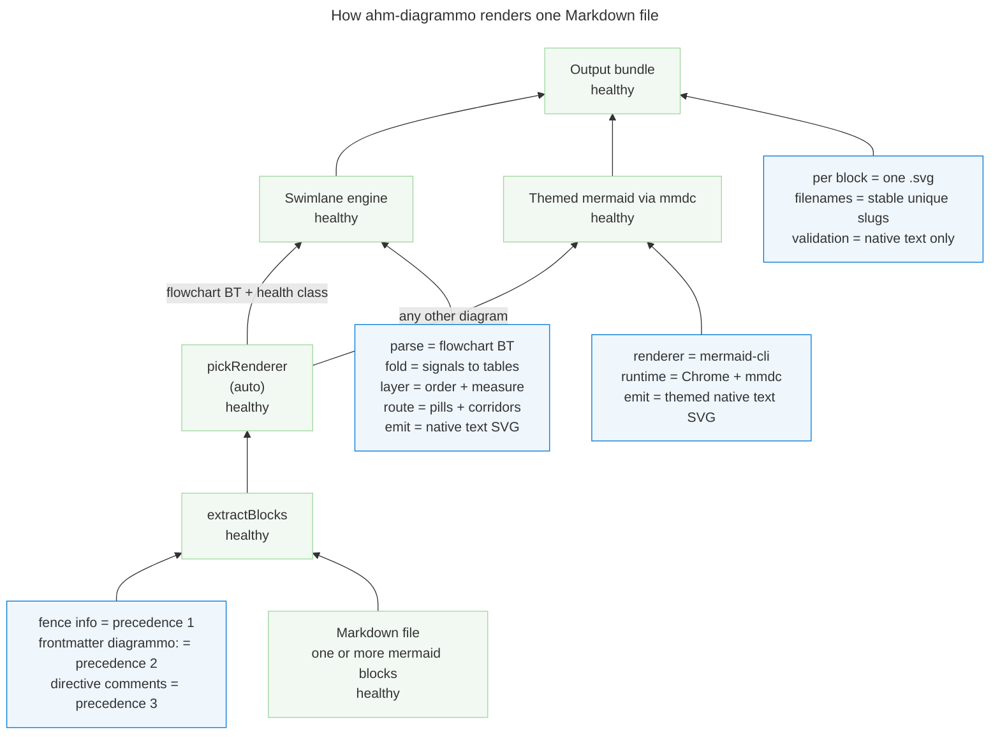

# How ahm-diagrammo works

This page explains the tool with the tool. The figure below is a health model that
ahm-diagrammo renders of its own pipeline, so what you read here is what the swimlane
engine actually draws.

For editing, [open the browser editor](https://abossard.github.io/ahm-diagrammo/).
For publishing, run the CLI from a [checkout](../README.md#usage).
Both call `prepareDocuments` in `src/document.mjs`: one browser-safe calculation handles hidden
source, options, renderer selection, stable batch slugs and raw Markdown locations. Neither host
reimplements that policy. The browser owns DOM/status/Canvas/download; the CLI owns file reads,
renderer subprocesses, logging, exits and atomic Markdown writes.

Regenerate the figure from this file:

```bash
node bin/diagrammo.mjs docs/how-it-works.md -o docs/assets
```

That writes `docs/assets/how-it-works-pipeline.svg`, which this page and the README embed.

## The pipeline, as a health model

Read it bottom-up, the way the swimlane engine rolls state toward the root. A Markdown
file enters at the bottom; the output bundle sits at the top. Four signal tables explain the
pipeline: option channels fold into extraction, renderer requirements fold into each renderer,
swimlane stages fold into the swimlane engine, and artifacts fold into the output bundle.



## What each lane shows

| Lane | Stage | Code | Verified by |
|------|-------|------|-------------|
| Markdown input | Hosts obtain source; preparation decodes and locates every Mermaid block | `prepareDocuments` in `src/document.mjs` | `document.test.mjs`; `cli.test.mjs`; `web-browser.test.mjs` |
| Extraction | Merge options from three channels, validate keys and values | `buildBlock` in `src/extract.mjs` | `extract.test.mjs` — option merge, precedence, issues |
| Selection | Select swimlane for health models, Mermaid otherwise (browser reports Mermaid as unsupported) | `prepareDocuments` reuses `looksLikeHealthModel` in `src/swimlane.mjs` | `document.test.mjs`; `web-convert.test.mjs`; `swimlane.test.mjs` |
| Renderers | Draw the SVG: the pure-Node swimlane engine, or themed mermaid through `mmdc` | `renderSwimlane` in `src/swimlane.mjs`, `renderMermaid` in `src/mermaid.mjs` | `swimlane.test.mjs`; `mermaid.test.mjs` |
| Output bundle | Write one SVG per block with stable, unique names | `bin/diagrammo.mjs` | `cli.test.mjs` — healthy, multi-file, duplicate-slug, and sync-identity subprocess cases |

The three signal channels merge with later channels winning: **fence info < frontmatter
`diagrammo:` < `%%|` directives**. See [FEATURES.md](FEATURES.md#per-block-options) for the
full option table and [FEATURES.md](FEATURES.md#renderer-selection) for the selection rule.

The unchanged figure's `pickRenderer` label names the selection stage. Its former CLI-local
function now lives within shared preparation; the render stages and published SVG are unchanged.

`docs.test.mjs` verifies that the source regenerates cleanly and that the committed SVG
ships under `docs/`, uses native text, and appears in the documentation.
