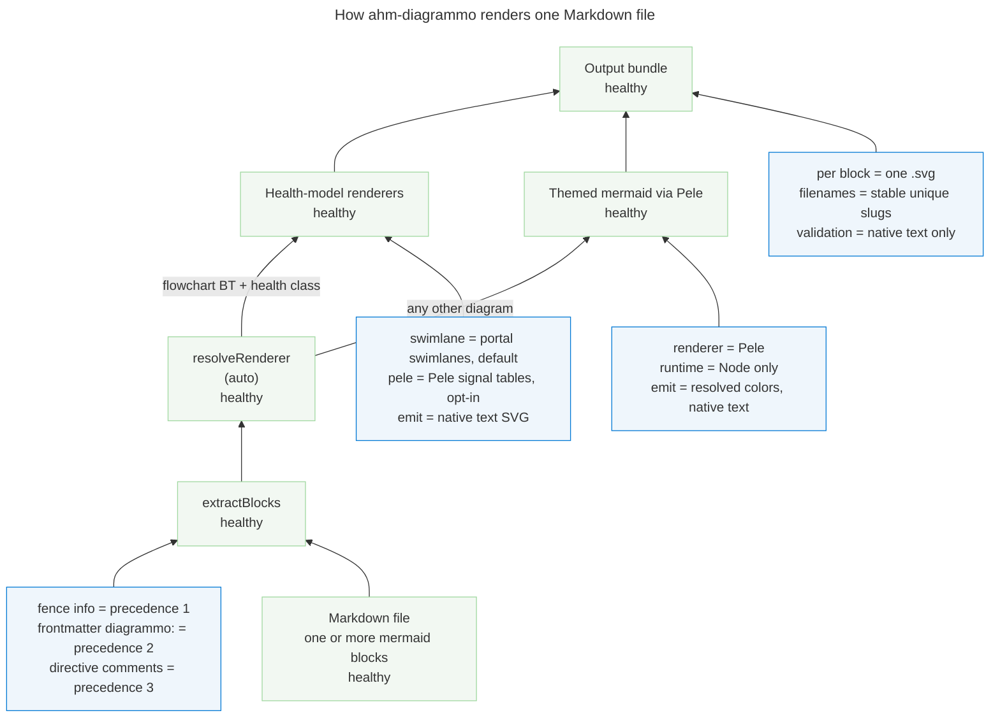

# How ahm-diagrammo works

This page explains the tool with the tool. The figure below is a health model that
ahm-diagrammo renders of its own pipeline, so what you read here is what the swimlane
engine actually draws.

Run the CLI from a [checkout](../README.md#usage). It calls `prepareDocuments` in
`src/document.mjs` for hidden source, options, renderer selection, stable batch slugs and raw
Markdown locations, then `renderDiagram` in `src/render.mjs` for every block. The CLI owns file
reads, logging, exits and atomic Markdown writes. Library callers use the same two functions.

Regenerate the figure from this file:

```bash
node bin/diagrammo.mjs docs/how-it-works.md -o docs/assets
```

That writes `docs/assets/how-it-works-pipeline.svg`, which the README embeds.

## The pipeline, as a health model

Read it bottom-up, the way the swimlane engine rolls state toward the root. A Markdown
file enters at the bottom; the output bundle sits at the top. Four signal tables explain the
pipeline: option channels fold into extraction, the health-model looks fold into the AHM
renderers, Pele details fold into the plain renderer, and artifacts fold into the output bundle.



## What each lane shows

| Lane | Stage | Code | Verified by |
|------|-------|------|-------------|
| Markdown input | Decode hidden source and locate every Mermaid block | `prepareDocuments` in `src/document.mjs` | `document.test.mjs`; `cli.test.mjs` |
| Extraction | Merge options from three channels, validate keys and values | `buildBlock` in `src/extract.mjs` | `extract.test.mjs` — option merge, precedence, issues |
| Selection | `auto`: swimlane for health models, mermaid otherwise. `pele`: Pele AHM look for health models, mermaid otherwise | `resolveRenderer` in `src/render.mjs` | `document.test.mjs`; `render-diagram.test.mjs` |
| Renderers | Draw the SVG: the swimlane engine, the Pele AHM renderer, or themed Pele for any other diagram | `renderDiagram` in `src/render.mjs` dispatching to `renderSwimlane`, `renderAhm`, `renderMermaid` | `swimlane.test.mjs`; `ahm-render.test.mjs`; `mermaid.test.mjs` |
| Output bundle | Write one SVG per block with stable, unique names | `bin/diagrammo.mjs` | `cli.test.mjs` — healthy, multi-file, duplicate-slug, and sync-identity subprocess cases |

The three signal channels merge with later channels winning: **fence info < frontmatter
`diagrammo:` < `%%|` directives**. See [FEATURES.md](FEATURES.md#per-block-options) for the
full option table and [FEATURES.md](FEATURES.md#renderer-selection) for the selection rule.

`docs.test.mjs` verifies that the source regenerates cleanly and that the committed SVG
ships under `docs/`, uses native text, and appears in the documentation.

## Inside the Pele AHM renderer

`renderAhm()` (the `pele` look) follows its own pipeline:

1. Validate input source and options with `parseAhmSource`.
2. Build normalized Pele source with `buildPeleAhmSource`.
3. Render with Pele public APIs.
4. Apply AHM semantic palette mapping and static SVG safety checks.
5. Return deterministic `{ svg, width, height, diagnostics }`.

Validation/limit ownership:

- `options` must be an object (`null` and scalar values are invalid).
- `limit` constrains authored input.
- `outputLimit` constrains final serialized SVG output, including table and legend bytes.
- `tableHeaders` is boolean. Default `true`; `false` removes only the table header row and reserved header height.
- `lanes` uses ordinary flowchart compound regions (`subgraph`) when enabled. Native Pele placement remains authoritative, including known off-center roots in shared-DAG shapes.

State ownership is caller-local:

- callers pre-calculate entity and signal states
- ahm-diagrammo maps those states to visual tokens
- signals render as in-card table rows (Signal, Value, State) using supplied row data
- table headers keep aligned left margins; with `tableHeaders: false` only header chrome is removed
- row state colors stay independent from entity state
- entity health badge stays in the header top-right, including entities without signal rows
- relationship labels are rendered only when authored in the source and stay attached to their edges
- quoted connection labels keep valid punctuation and escapes from source
- no local health aggregation or evaluation is performed

When the CLI hands a block to `renderAhm`, `renderDiagram` drops frontmatter, `%%|` directives
and `classDef` lines first (preview-only colors; the AHM palette comes from the theme) and
renders with `lanes: true`.
