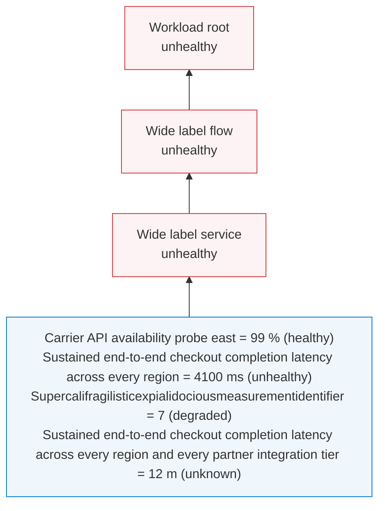

# Long-signal-label fixture (test only)

Not a shipped example. Every shipped signal name is comfortably narrower than the 136px label
column, so containment there is a property of the data rather than of the layout. These names are
authored past the column — one just over it, one that needs three lines, one single unbreakable token, and one long
enough to be ellipsized — so the containment has to be structural to hold.

