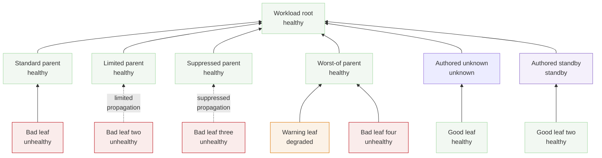

# Rollup-semantics fixture (test only)

Not a shipped example and never rendered into `drawio/examples/`. It exists so every branch of the
propagation matrix the shipped inventories do not exercise together reaches the generator at once:
all three impacts, a two-parent worst-of whose parents disagree, an authored `unknown` fed only
Healthy inputs and an authored `standby` fed only Healthy inputs.

