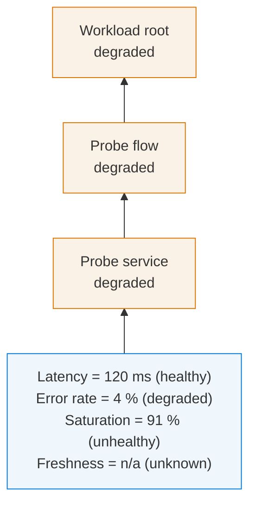

# Signal-state fixture (test only)

Not a shipped example and never rendered into `drawio/examples/`. It exists so every signal state
the parser can actually produce reaches the Draw.io runtime at least once — including `unknown`,
which no shipped inventory authors — and so the glyph/colour pairing is measured on rendered cells
rather than on the generator's own map.

