## Kitchen sink health model

A synthetic health model that exercises every feature of both health-model renderers.

All supplied example readings and states in this specimen are demonstration data.

```mermaid
flowchart BT
    webSig["Web latency = 176 ms (healthy)<br/>HTTP 5xx rate = 0.22% (healthy)<br/>Request rate = 2.08k/s (healthy)<br/>Availability = 99.95% (healthy)"] --> web["Web frontend<br/>healthy"]
    apiSig["Request rate = 1.54k/s (healthy)<br/>P95 latency = 420 ms (degraded)<br/>429 rate = 2.4% (degraded)<br/>Error rate = 5.6% (unhealthy)"] --> api["API service<br/>degraded"]
    dbSig["Connection pool = 83% (degraded)<br/>DTU utilization = 68% (healthy)<br/>Failed connections = 0.6/min (degraded)<br/>Replication lag = 11 s (degraded)<br/>Deadlocks = 4/h (unhealthy)"] --> db["Database<br/>healthy"]
    cacheSig["Hit ratio = 62% (unhealthy)<br/>Eviction rate = 6.1% (degraded)<br/>Memory pressure = 94% (unhealthy)"] --> cache["Redis cache<br/>unhealthy"]
    queueSig["Queue depth = 57 (unhealthy)<br/>Oldest message age = 28 s (degraded)<br/>Dead-letter count = 12 (unhealthy)"] --> queue["Order queue<br/>degraded"]
    stgSig["Availability = 99.99% (healthy)<br/>Throttling rate = 0.03% (healthy)"] --> stg["Blob storage<br/>healthy"]
    authSig["Token failures = 0.9% (degraded)<br/>MFA challenges = 7.4% (healthy)<br/>Sign-in latency = 310 ms (degraded)"] --> auth["Identity provider"]
    searchSig["Index lag = 38 s (degraded)<br/>Query latency = 145 ms (healthy)<br/>Error rate = 0.19% (healthy)"] --> search["Search service<br/>healthy"]
    shipSig["Carrier API availability = 99.97% (healthy)<br/>Carrier API latency = 690 ms (degraded)<br/>Error rate = 8.8% (unhealthy)"] --> ship["Shipping service with a long name<br/>healthy"]
    fnSig["Invocation errors = 4.7% (unhealthy)<br/>Duration = 1.9 s (degraded)<br/>Throttles = 14/min (degraded)"] --> fn["Background functions<br/>degraded"]

    web --> shop["Shop and commerce<br/>(active-active)<br/>healthy"]
    api --> shop
    db --> shop
    cache -. "limited<br/>propagation" .-> shop
    db --> reporting["Reporting<br/>(single region)<br/>degraded"]
    search --> reporting
    queue --> logistics["Logistics and fulfillment<br/>degraded"]
    ship --> logistics
    fn --> logistics
    auth --> account["Account and identity<br/>unknown"]
    stg --> account
    secSig["Replication health = 100% (healthy)<br/>Failover readiness = 91% (degraded)"] --> secondary["Secondary region<br/>standby"]
    shop --> root["Workload root<br/>(worstOf)<br/>degraded"]
    reporting -. "suppressed<br/>propagation" .-> root
    logistics --> root
    account --> root
    secondary --> root

    classDef blue fill:#eff6fc,stroke:#0078D4;
    classDef green fill:#f2f8f2,stroke:#a0d8a0;
    classDef amber fill:#fbf2e7,stroke:#db7500;
    classDef red fill:#faeceb,stroke:#ba0d16;
    classDef purple fill:#f4f0fb,stroke:#8661c5;
    class webSig,apiSig,dbSig,cacheSig,queueSig,stgSig,authSig,searchSig,shipSig,fnSig,secSig blue;
    class web,db,stg,search,ship,shop green;
    class api,queue,fn,reporting,logistics,root amber;
    class cache red;
    class secondary purple;
```

