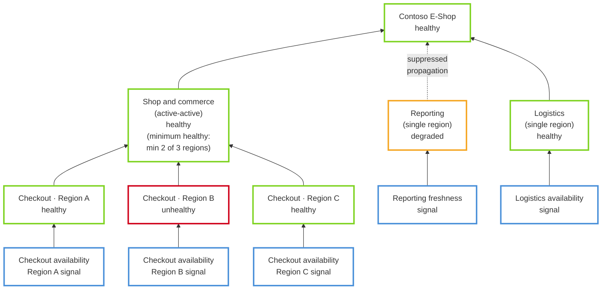

# Shop and commerce multi-region health

Real consumer fixture: the `Shop and commerce` card carries a long subtitle
(`active-active · minimum healthy: · min 2 of 3 regions`) on the same row as its
right-aligned status pill. Regression guard for the subtitle-under-pill overlap.

